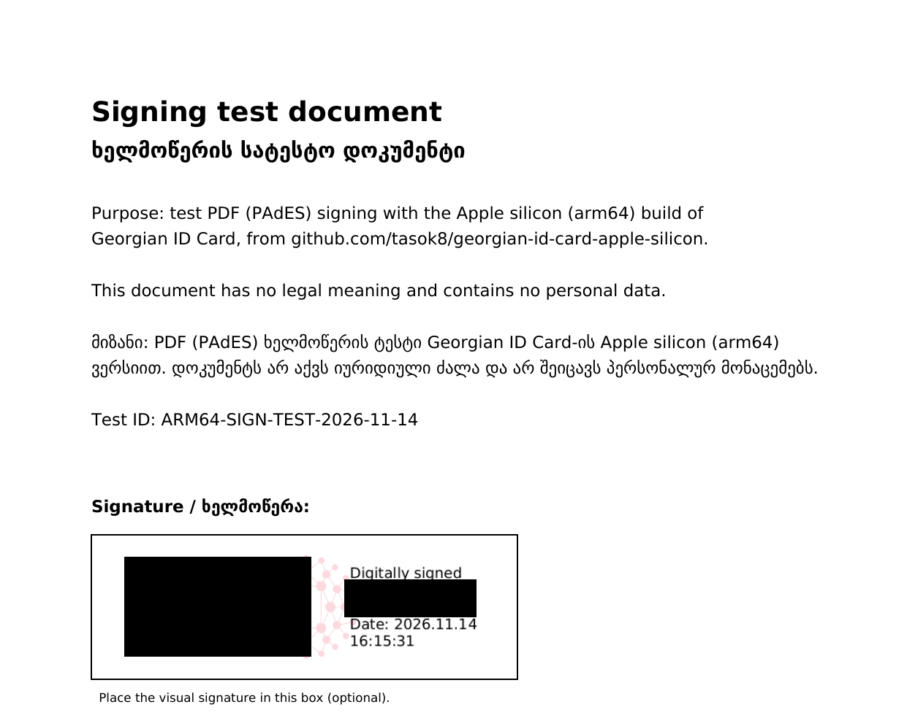

[English](README.md) | **ქართული**

# Georgian ID Card — Apple silicon-ისთვის (არაოფიციალური)

**არაოფიციალური** ინსტრუქცია, რომლითაც ოფიციალური [Georgian ID Card](https://id.ge) macOS აპლიკაცია
(`ge.id.card.Georgian-ID-Card`, ვერსია 1.0 / პლაგინები 2.0.1) Apple silicon-იან Mac-ებზე პირდაპირ,
Rosetta-ს გარეშე მუშაობს.

ეს რეპოზიტორია **არ შეიცავს** სახელმწიფო სერვისების განვითარების სააგენტოს (PSDA) კოდს და **არც მზა
აპლიკაციას** — მხოლოდ პატარა ლაუნჩერის წყაროს კოდს, აწყობისა და შემოწმების სკრიპტებს და დოკუმენტაციას.
აპლიკაციას თქვენ თავად აწყობთ **თქვენს კომპიუტერზე დაინსტალირებული** ოფიციალური აპლიკაციიდან.

> პროექტი არ არის დაკავშირებული სახელმწიფო სერვისების განვითარების სააგენტოსთან (PSDA) და არ არის
> მის მიერ დამტკიცებული. ოფიციალური პროგრამისა და მხარდაჭერისთვის გამოიყენეთ https://id.ge.

## მტკიცებულება: ხელმოწერა მუშაობს

სატესტო PDF, ხელმოწერილი საქართველოს პირადობის მოწმობით ამ Apple silicon ვერსიაში (macOS 26.3.1,
ნატიური გაშვება). დამოუკიდებელი ვალიდატორი ადასტურებს, რომ ხელმოწერა **ვალიდურია** — PAdES სანდო
დროის შტამპით და გრძელვადიანი ვალიდაციის მონაცემებით. სახელი და პირადი ნომერი დაფარულია.
[დეტალები](docs/evidence/README.md)



## პრობლემა

ოფიციალური macOS აპლიკაცია მხოლოდ Intel-ისთვისაა. Apple silicon-ზე ის Rosetta 2-ით მუშაობს, macOS კი
აფრთხილებს, რომ macOS 28-ში ის აღარ გაეშვება, რადგან Apple Rosetta-ს ეტაპობრივად აუქმებს.

## რა გაირკვა

Intel-ზე დამოკიდებულია მხოლოდ შეფუთვა. თავად აპლიკაცია 100 %-ით Java-ზეა დაწერილი (OSGi/Equinox +
JavaFX). bundle-ის მხოლოდ ორი ნაწილია განკუთვნილი მხოლოდ x86_64-ისთვის:

1. `Contents/MacOS/Georgian ID Card` — პატარა ლაუნჩერი, რომელიც Java-ს უშვებს.
2. `Contents/Resources/jre` — თანდართული x86_64 Java 14 + JavaFX 14 runtime.

სმარტ-ბარათთან წვდომა ხდება გზით `javax.smartcardio` → macOS `PCSC.framework` → Apple-ის ჩაშენებული
CCID დრაივერი, ამიტომ მწარმოებლის დრაივერი საჭირო არ არის. სმარტ-ბარათის ერთადერთი ნატიური ნაწილი
JDK-ის საკუთარი `libj2pcsc`-ია, რომელიც ახალ runtime-ში arm64-ისთვის არის. პლაგინებში არსებული JNA და
proxy-ს ნატიური ბიბლიოთეკები მხოლოდ Windows-ზე გამოიყენება. დეტალები (ინგლისურად):
[docs/CHANGES.md](docs/CHANGES.md).

## გადაწყვეტა

| ცვლილება | დეტალები |
|---|---|
| ახალი ლაუნჩერი | ~60-ხაზიანი ნატიური arm64 C პროგრამა ([`src/launcher/main.c`](src/launcher/main.c)), ორიგინალის იდენტური ქცევით |
| ახალი runtime | Azul Zulu 17 LTS + JavaFX 17 macOS aarch64-ისთვის, დაფიქსირებული SHA-256-ით, `jlink`-ით აწყობილი ორიგინალის მოდულების ნაკრებზე |
| `Info.plist` | მინიმუმ macOS 11, arm64 არქიტექტურის პრიორიტეტი |
| ხელმოწერა | ad-hoc (ლოკალური გამოყენებისთვის); Developer ID-ის მხარდაჭერა `CODESIGN_IDENTITY`-ით |
| **უცვლელი** | **ყველა `.jar` ფაილი ბაიტ-ბაიტ იდენტურია ოფიციალური აპლიკაციისა** — ბარათის, PIN-ის, სერტიფიკატისა და ხელმოწერის ლოგიკა არ შეცვლილა |

## რეპოზიტორიის შიგთავსი

| ბილიკი | რა არის |
|---|---|
| `src/launcher/main.c` | ნატიური arm64 ლაუნჩერის წყაროს კოდი |
| `src/build.sh` | აწყობს arm64 აპლიკაციას თქვენი ოფიციალური ინსტალაციიდან |
| `src/verify.sh` | აუდიტი: ამოწმებს, რომ ყველა jar იდენტურია, და აჩვენებს ყველა სხვა განსხვავებას |
| `src/entitlements.plist` | hardened runtime-ის უფლებები Developer ID რელიზისთვის |
| `src/tests/PcscProbe.java` | PC/SC-ის მხოლოდ წამკითხველი ტესტი (ბარათს არასოდეს მიმართავს) |
| `docs/INSTALL.md` | აწყობისა და ინსტალაციის ინსტრუქცია |
| `docs/CHANGES.md` | კვლევა, ცვლილებები, ტესტის შედეგები |
| `docs/RELEASE-CHECKLIST.md` | ნებართვა, ლიცენზიები, ხელმოწერა და ნოტარიზაცია — რაც ნებისმიერი ოფიციალური რელიზისთვისაა საჭირო |

`docs/` საქაღალდის დოკუმენტები ინგლისურ ენაზეა.

## მოთხოვნები

- Apple silicon-იანი Mac, macOS 11 ან უფრო ახალი
- Xcode Command Line Tools (`xcode-select --install`)
- ოფიციალური აპლიკაცია, დაინსტალირებული `/Applications/Georgian ID Card.app`-ში (გამოიყენება მხოლოდ წასაკითხად)
- ინტერნეტი პირველი აწყობისთვის (Java runtime ჩამოიტვირთება `cdn.azul.com`-დან)

## აწყობა და გამოყენება

```bash
src/build.sh                     # -> build/Georgian ID Card.app
src/verify.sh                    # შედარება /Applications/Georgian ID Card.app-თან
```

პარამეტრები: `ORIG_APP=…`, `JDK_HOME=…`, `CODESIGN_IDENTITY="Developer ID Application: …"`, ხოლო
`src/build.sh --dist` ქმნის zip/DMG-ს (მხოლოდ ლოკალური ან PSDA-ს მიერ ტესტირებისთვის — იხ. ქვემოთ).
ინსტალაცია და პირველი გაშვება: [docs/INSTALL.md](docs/INSTALL.md).

## ტესტის შედეგები (მოკლედ)

ტესტირება ჩატარდა ორ Apple silicon-იან Mac-ზე (macOS 27.2.1 და 26.3.1). სრული ცხრილები:
[docs/CHANGES.md](docs/CHANGES.md); ხელმოწერის მტკიცებულება: [docs/evidence](docs/evidence/README.md).

- **გავიდა:** ყველა Mach-O ფაილი arm64-ია; აპლიკაცია მუშაობს ნატიურად (ტრანსლაციის გარეშე); 16-ვე OSGi bundle ეშვება; მთავარი ფანჯარა იხსნება
- **გავიდა:** დახურვა, ხელახლა გაშვება, მეორე გაშვებისას არსებული ფანჯრის გააქტიურება; ჩაშენებული განახლების შემოწმება id.ge-ზე
- **ბარათის მფლობელის თქმით მუშაობს:** წამკითხველისა და ბარათის ამოცნობა, ბარათის ინფორმაცია, სერტიფიკატები, PIN-ის შემოწმება, ხელმოწერა, ვებ-ხელმომწერი
- **გავიდა (მეორე Mac, 2026-11-14):** ახალი აწყობა ამ რეპოზიტორიიდან, ნატიური გაშვება, PDF-ის ხელმოწერა პირადობის მოწმობით — დამოუკიდებლად გადამოწმდა, როგორც PAdES baseline LT სანდო დროის შტამპით
- **არ შემოწმებულა:** სერტიფიკატის განახლება, eSeal ბარათი, PIN-pad წამკითხველები, PIN-ის შეცვლა/PUK-ით განბლოკვა, მეორე Mac, ახალი მომხმარებლის ანგარიში, **macOS 28**

## შეზღუდვები

- **არაოფიციალური და მხარდაჭერის გარეშე.** გამოიყენეთ საკუთარი პასუხისმგებლობით; ოფიციალური მხარდაჭერისთვის მიმართეთ PSDA-ს.
- ხელმოწერილია ad-hoc და **ნოტარიზაციის გარეშე**. Gatekeeper მას დაბლოკავს, თუ ის ჩამოტვირთულია და არა ლოკალურად აწყობილი.
- აპლიკაცია ლოგებსა და პარამეტრებს საკუთარ bundle-ში ინახავს (ისევე, როგორც ოფიციალური აპლიკაცია).
  `debug.log` შეიძლება სერტიფიკატის დეტალებს შეიცავდეს — ნუ გაუზიარებთ სხვებს.
- **ნუ გაავრცელებთ აწყობილ აპლიკაციას.** ოფიციალური აპლიკაცია საკუთრებითი პროგრამაა
  (© 2019 Giorgi Giorkhelidze, ავრცელებს PSDA). ნებისმიერი გავრცელებისთვის საჭიროა PSDA-ს ნებართვა;
  იხ. [docs/RELEASE-CHECKLIST.md](docs/RELEASE-CHECKLIST.md). სასურველი გზაა, რომ PSDA-მ თავად
  გამოუშვას ოფიციალური Apple silicon ვერსია.

## ავტორები და მადლობა

- **Georgian ID Card** აპლიკაცია: © 2019 Giorgi Giorkhelidze, ავრცელებს საქართველოს სახელმწიფო სერვისების
  განვითარების სააგენტო (PSDA, id.ge). მისი კოდი აქ არ შედის.
- Java runtime: Azul Zulu (OpenJDK + OpenJFX, GPLv2 Classpath Exception-ით), ჩამოიტვირთება აწყობისას.
- პროექტის ავტორი: ანასტასია კუძეშვილი ([@tasok8](https://github.com/tasok8)) — გამოავლინა პრობლემა,
  წარმართა კვლევა, ააწყო და გატესტა აპლიკაცია თავის Mac-ზე ბარათის მფლობელთან ერთად, გადახედა
  ცვლილებებს და გამოაქვეყნა ეს რეპოზიტორია.
- **AI-ის დახმარება:** კვლევა, ლაუნჩერი, სკრიპტები და დოკუმენტაცია შეიქმნა AI ასისტენტის დახმარებით
  და გამოქვეყნებამდე გადამოწმდა.

## ლიცენზია

ამ რეპოზიტორიის ფაილები ვრცელდება [MIT ლიცენზიით](LICENSE). ეს **არ** ეხება Georgian ID Card
აპლიკაციას ან მასში შემავალ სხვა პროგრამულ უზრუნველყოფას.
