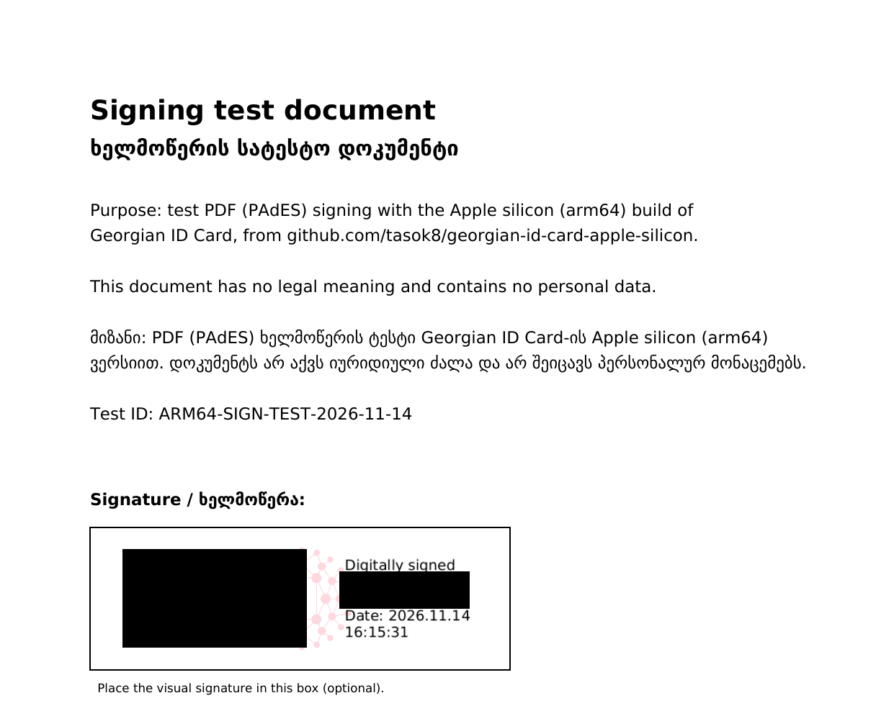

# Signing test evidence – 2026-11-14

Independent re-test on a second Apple silicon Mac (macOS 26.3.1), using an app built from a fresh
clone of this repository with `src/build.sh`.

## What was done

1. [`signing-test.pdf`](signing-test.pdf) (a blank test document with no personal data) was signed
   with a Georgian ID card in **Georgian ID Card (Apple silicon)**, running natively
   (Activity Monitor: Kind = Apple). The PIN was entered only in the app's own dialog.
2. The signed file was checked with an independent validator (poppler `pdfsig`) and by inspecting
   the signature structure.

## Result

| Check | Result |
|---|---|
| Signature created with visual stamp | Pass – signed 2026-11-14 16:15:31 |
| Signature integrity (`pdfsig`) | Pass – "Signature is Valid" |
| Signature format | PAdES (`ETSI.CAdES.detached`), SHA-256 |
| Trusted timestamp (RFC 3161) embedded | Yes – timestamp server reached from the arm64 build |
| Long-term validation data (DSS with certificates + OCSP) | Yes – PAdES baseline LT |
| Certificate chain | Not checked here – the Georgian root CA is not in the validator's trust store |

## Privacy

The signed PDF itself is **not** published: it contains the card holder's certificate (full name
and personal number). The image above is a rendering of the signed page with the name and personal
number blacked out. Only the date and time of the visual stamp are left visible.

## Native execution

| Screenshot | Shows |
|---|---|
| [app-icons.png](app-icons.png) | Official app and this build installed side by side |
| [activity-monitor-apple-silicon.png](activity-monitor-apple-silicon.png) | This build: Kind = Apple (native arm64) |
| [activity-monitor-intel.png](activity-monitor-intel.png) | Official app: Kind = Intel (Rosetta) |
